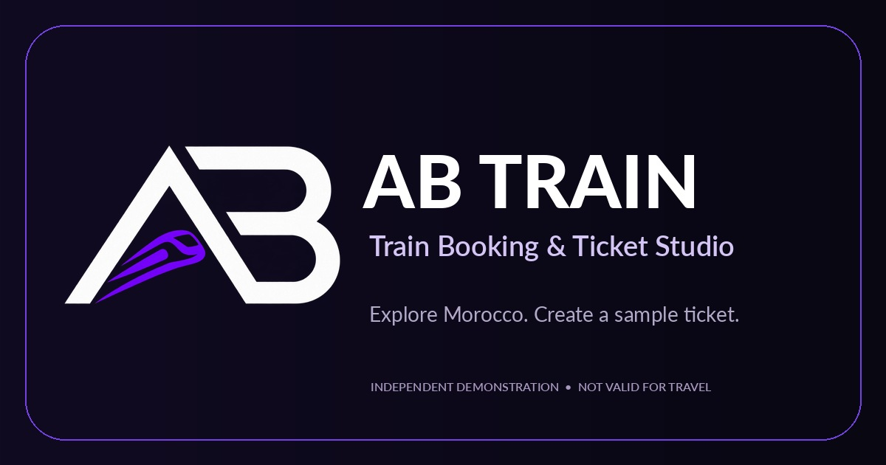
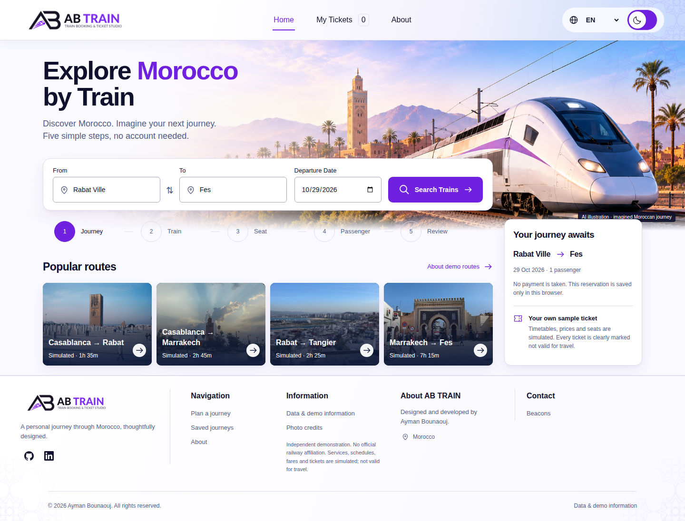
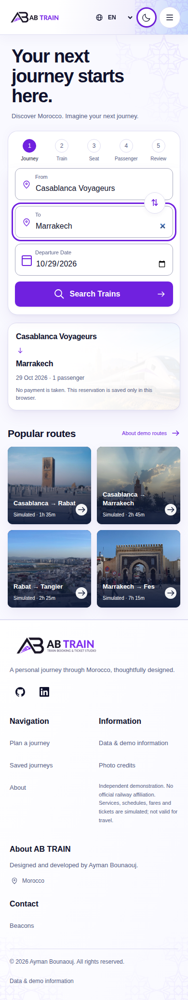
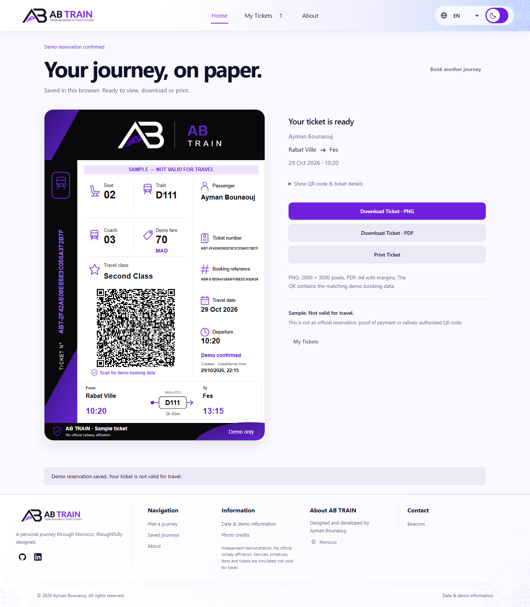

<div align="center">



# AB TRAIN
### Train Booking & Ticket Studio

**A multilingual, browser-based railway journey experience inspired by Morocco.**

Explore routes, plan a simulated journey, choose a seat and create beautifully presented sample tickets — all through an independent, locally running web application.

[**🚆 Launch Live Demo**](https://aymanbouanouj.github.io/ab-train-ticket-studio/) · [View Deployment](https://github.com/aymanbouanouj/ab-train-ticket-studio/actions/workflows/deploy-pages.yml) · [Get Started](#quick-start) · [Licensing](#license-and-ownership)

[](https://github.com/aymanbouanouj/ab-train-ticket-studio/actions/workflows/deploy-pages.yml)

<sub>Independent demonstration · No real reservations or payments · Not affiliated with ONCF</sub>

</div>

---

## Overview

**AB TRAIN** is an end-to-end *railway booking simulation* designed to bring together product-focused UI engineering, multilingual accessibility, structured geographic data and client-side ticket generation.

Rather than presenting static screens, the project lets visitors explore a complete sample journey — from selecting registered stations to reopening a saved ticket. Its booking rules, schedules, prices and seat availability are **simulated**, not live railway information.

| **Stations** | **Languages** | **Demo corridors** | **Ticket formats** |
| :---: | :---: | :---: | :---: |
| **22** supported station records | **EN · FR · ES · AR** | **4** simulated corridors | **QR · PNG · PDF · Print** |

## Highlights

| Experience | What you can do |
| --- | --- |
| **Station-first journey search** | Search both **From** and **To** using the 22 supported stations, multilingual aliases, accent-insensitive matching and keyboard controls. Cities or localities are never presented as bookable stations. |
| **Simulated routes and connections** | Explore the Atlas, Northern, Coastal and Airport demo corridors, with route validation, explicit connection suggestions and support for next-day arrivals where applicable. |
| **Booking and seating** | Select a travel date, available simulated service, travel class, coach and seat; complete passenger details and review the resulting sample ticket. |
| **Ticket studio** | Generate a ticket with a QR code; view it again, export to PNG/PDF or open the print view. Every ticket is a **sample, not valid for travel**. |
| **Multilingual by design** | Switch between English, French, Spanish and Arabic, including right-to-left layouts for Arabic and localized station labels and messages. |
| **Responsive, accessible interface** | Use light/dark themes, mobile and desktop layouts, keyboard-operable selectors, focus feedback and reduced-motion preferences. |
| **Browser-local history** | Reopen saved journeys in the same browser without creating an account or connecting to a booking server. |

## Screenshots

Authentic screenshots captured by Playwright against a local production build using **synthetic demo data**.

**Desktop — journey planner**



<details>
<summary><strong>Mobile — responsive journey search</strong></summary>



</details>

<details>
<summary><strong>Sample ticket and QR</strong></summary>



</details>

## Try the live experience

**[Open AB TRAIN →](https://aymanbouanouj.github.io/ab-train-ticket-studio/)**

1. **Plan** — choose a departure station, destination and travel date.
2. **Explore** — choose a supported *simulated* journey and class.
3. **Personalize** — enter a sample passenger name and select an available seat.
4. **Confirm** — review the ticket's clearly marked demonstration status.
5. **Keep or export** — revisit it in **My Tickets**, display its QR code, or use PNG/PDF/print.

> [!IMPORTANT]
> **AB TRAIN is an independent portfolio demonstration.** It is not operated, authorized or endorsed by ONCF. It does **not** sell tickets, take payments, issue valid train reservations, or provide real-time railway availability, schedules or fares.

## Engineering and architecture

Built with **JavaScript (ES modules), HTML, CSS and Vite**, with QR generation and PDF exports performed in the client-side experience.

| Area | Implementation |
| --- | --- |
| **Application interface** | `index.html`, `app.js`, and the responsive stylesheets |
| **Station search and localization** | `src/locations.js`, `src/i18n.js`, `src/i18n/translations.json` |
| **Journey and booking rules** | `src/booking.js` |
| **Sample tickets and exports** | `src/ticket.js`, `src/brand.js` |
| **Saved bookings** | `src/storage.js` with browser-local persistence |
| **Geographic and station evidence** | The versioned files in `data/`, distinct from the 22-station booking registry |
| **Public deployment** | Vite build and GitHub Actions → GitHub Pages |
| **Release output checks** | `scripts/check-publication.mjs` scans the production artifact for specified sensitive patterns and excluded files |

**Design approach:** one independent browser app, explicit demo rules, preserved station identities, language-aware presentation and reusable ticket rendering. There is no backend, live ONCF integration or passenger-account service.

### Repository map

```text
.
├── .github/workflows/    # GitHub Pages build and deployment
├── AB-TRAIN-Logo-Pack/    # Authoritative original brand assets
├── data/                  # Geographic datasets and station evidence
├── docs/                  # Provenance and public project documentation
├── public/                # Runtime branding, images, icons and credits
├── scripts/               # Maintenance and publication checks
├── src/                   # Search, booking, localization, storage, tickets
├── tests/                 # Unit and browser test coverage
├── app.js                 # Main application entry
├── index.html             # HTML shell
├── package.json           # Commands and dependencies
└── vite.config.js         # Local and GitHub Pages base paths
```

## Quick start

**Prerequisites:** Node.js **22.12+** and npm. Node.js 24 is used by the GitHub Actions workflow.

```bash
git clone https://github.com/aymanbouanouj/ab-train-ticket-studio.git
cd ab-train-ticket-studio

npm ci
npm run dev
```

Open the development URL printed by Vite (normally `http://127.0.0.1:5173`). Do not open `index.html` directly from the filesystem; the app uses browser ES modules.

Build and preview the production site locally:

```bash
npm run build
npm run preview
```

Vite generates `dist/` for deployment. Local development runs at the site root; the GitHub Pages workflow builds with the repository's `/ab-train-ticket-studio/` base path.

## Quality, checks and deployment

```bash
npm test                    # Unit tests
npx playwright install chromium
npm run test:e2e            # Full browser test suite (local)
```

The project has **32 unit tests** and an existing **39-test Playwright suite** covering station selection, booking behavior, keyboard navigation, translations, RTL, themes, saved tickets and export workflows.

On deployment, [GitHub Actions](https://github.com/aymanbouanouj/ab-train-ticket-studio/actions/workflows/deploy-pages.yml) performs locked dependency installation, unit tests, a Vite production build and a publication-output privacy scan before deploying `dist/` to GitHub Pages.

**Verification scope (29 October 2026):** the full **39/39 Playwright browser tests passed** in the test stage of [GitHub Actions run #40956727928](https://github.com/aymanbouanouj/ab-train-ticket-studio/actions/runs/40956727928), including booking, QR, PNG/PDF export and print-flow checks. The overall run was marked **failed only in its later screenshot Git commit step**; its browser-test stage passed. The separate [README screenshot capture run #40957260206](https://github.com/aymanbouanouj/ab-train-ticket-studio/actions/runs/40957260206) subsequently succeeded. The standard PR pipeline runs 32 unit tests, a Vite build and the publication-output check. These checks do not guarantee complete security, physical printer behavior or compatibility with every device.

## Data, privacy and limitations

- **Station coverage:** 22 evidence-backed application records are available for booking selection, not a complete national or live station inventory. Geographic records are intentionally **not** bookable locations.
- **Source data:** geographic reference material is derived from attributed GeoNames and HCP sources; station eligibility references dated ONCF evidence. These data are not a live operational service. See [geographic provenance](docs/GEOGRAPHIC-DATA-PROVENANCE.md).
- **Local privacy:** language/theme preferences and demo ticket history are stored in the visitor's browser where storage is available. No login, passenger email address, payment details or remote booking account is required.
- **Shareable tickets:** names and journey details within QR codes, exported PNG/PDF files and printouts are **readable**. Use invented passenger details for demonstrations; there is no server-side ticket backup.
- **Third-party content:** destination photographs, geographic datasets and external icons have separate rights and notices; the full source and change attribution is documented below.

## License and ownership

**Copyright © 2026 Ayman Bounaouj.**

| Material | Terms |
| --- | --- |
| **Original AB TRAIN software source** | [GNU Affero General Public License v3.0 only (AGPL-3.0-only)](LICENSE) |
| **Original AB TRAIN logo, brand identity and separate artwork** | **All Rights Reserved** — see [COPYRIGHT.md](COPYRIGHT.md) |
| **Third-party photographs, datasets, icons and dependencies** | Their **own** licenses and attribution requirements — see [THIRD_PARTY_NOTICES.md](THIRD_PARTY_NOTICES.md) |

The **AGPL is an open-source license**: it permits compliant copying, modification, commercial use and redistribution, subject to its obligations, including relevant source-sharing requirements. It does **not** prohibit all reuse of the source code. Separately reserved branding/artwork does not become AGPL-licensed merely by being stored in the same repository.

For transparent provenance, see [publication and artwork provenance](docs/PUBLICATION-PROVENANCE.md), [photo credits](public/fidelity/credits.html), [icon notices](public/icons/README.md) and [brand guidelines](AB-TRAIN-Logo-Pack/docs/BRAND-GUIDELINES.md).

## Author and feedback

**Designed and developed by Ayman Bounaouj.**

[GitHub profile](https://github.com/aymanbouanouj) · [Project issues and feedback](https://github.com/aymanbouanouj/ab-train-ticket-studio/issues) · [Security policy](SECURITY.md)

Found an issue or have a suggestion? Open a GitHub issue with steps to reproduce. **Do not include private passenger information, credentials or exported real-person tickets in public issues.**

---

<div align="center">
  <sub>AB TRAIN · An independent Moroccan railway booking concept · © 2026 Ayman Bounaouj</sub>
</div>
